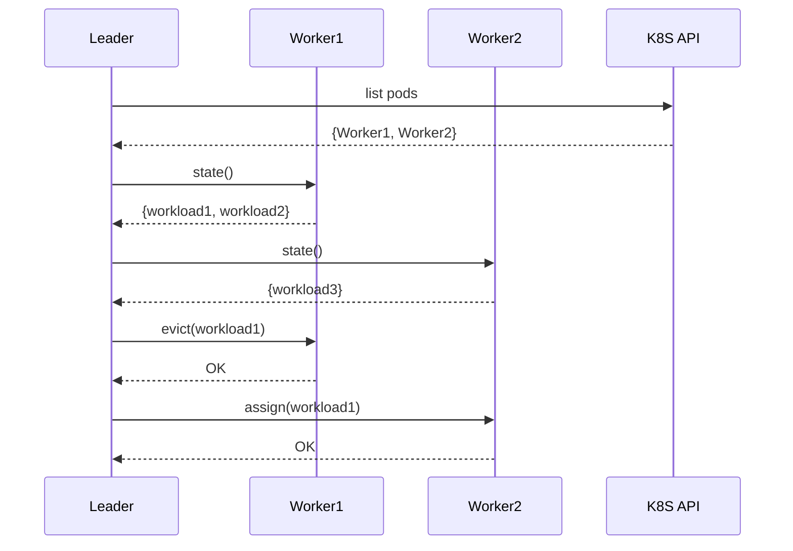
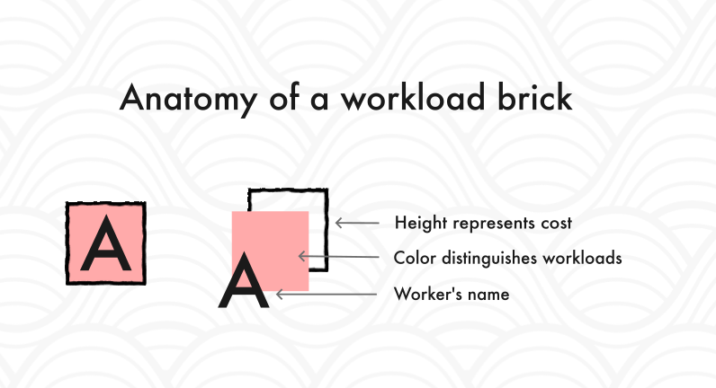
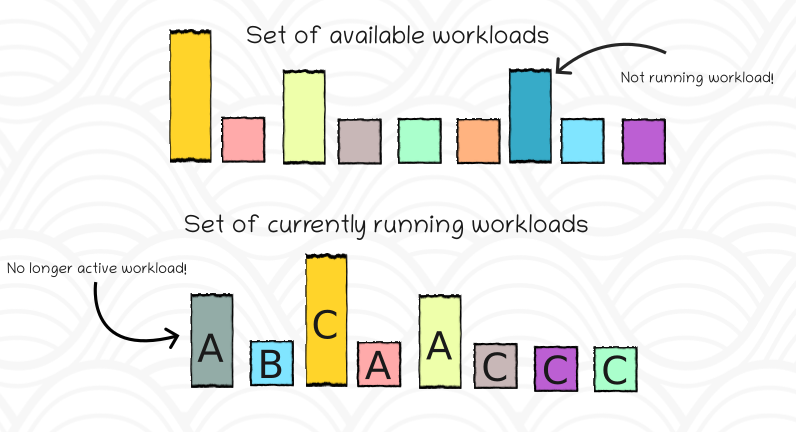
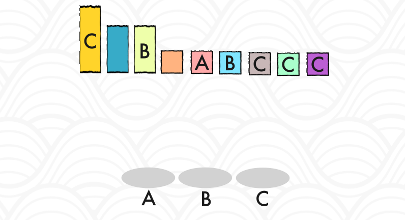
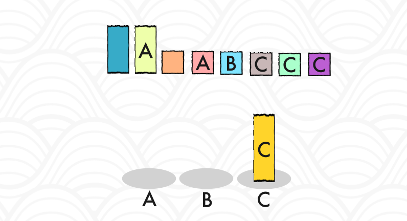
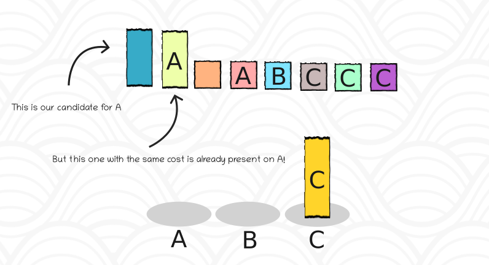
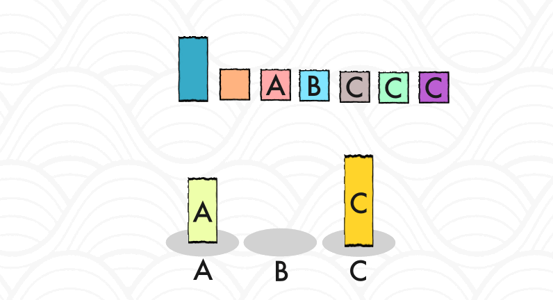

+++
date = '2026-11-07T15:20:00+02:00'
draft = false
title = 'Balancing never-ending workloads'
[params]
    featuredImage = "posts/06-workloads/featured_img.jpg"
+++
## The never-ending workloads
Let me tell you about a challenge I encountered more than a year ago when we started working on a new project. **I promise you: there will be some pictures later on.**

We were trying to collect and process data from customers' infrastructure in real time, all within our **Kubernetes clusters**. Instead of usual solutions where data is scraped by an agent and pushed to some queue, we had to run our "agents" in our own clusters to minimize customer's costs. Constantly tearing down and spinning up new workloads was not an option, so I had to come up with a solution how to handle workloads that must run constantly and indefinitely.

What were the requirements?
- Only active workloads can be running
- Workloads can vary in their resource requirements (their cost represented as a positive integer)
- Everything must be scalable (workers can be added or removed at any time)
- Workloads are atomic and cannot be split into smaller workloads
- Workers can crash or be restarted at any time (the system must detect missing workloads and reassign them)
- Minimal downtime must be ensured (balancing must be as non-disruptive as possible)
- Don't waste memory (multiple workloads on the same worker pod)

## What are the options?

### Leaderless

**Leaderless** approaches rely on each worker to independently claim and balance workloads among themselves. This works well for a small number of uniform workloads. Each worker needs to know the total number of workers and workloads to calculate its fair share. However, as the number of workloads grows, this approach can lead to imbalances and excessive requests to the coordination mechanism. The mechanism can be a database or a distributed service.

Another example, not using any leases, is *consistent hashing*. This approach doesn't need a coordinator and moves low number of workloads when the set of workers changes, but can lead to imbalances when workloads have varying costs.

### Leader-based

**Leader-based** approaches introduce a leader that is responsible for rebalancing workloads among workers. This simplifies the coordination because the leader is aware of the overall state and can make optimized decisions.

## Thus spoke the leader
Because of the requirements, I chose the leader-based approach. I didn't want to introduce a new service (RAM consumption and high availability concerns), so I decided to just elect a leader among the existing workers.

Workers expose an API with the following endpoints: `evict`, `assign` and `state`. The leader is responsible for calling these endpoints. This flow allows the leader to perform rebalancing at its own pace. Both `evict` and `assign` must be idempotent.

In my case, the leader discovers the workers by calling the Kubernetes API and listing all pods with a specific label. The leader can then call the `state` endpoint of each worker to get the current state of workloads.



## Stacking bricks
The leader's role is to coordinate the distribution of workloads among workers. It can calculate the desired state and emit commands to workers to achieve that state. This resembles how Kubernetes controllers operate.

It has to reconcile two sources:
- the list of all active workloads from a database 
- the current state of workers.

Any workload that is in the database but not running on any worker is considered unassigned. Any workload that is not in the database and is running on a worker is considered stale and must be evicted immediately.

Let's visualize the workloads as bricks of different heights, where the height represents the workload cost.



### The balancing act
The algorithm works as follows:
- The leader runs the reconciliation periodically. It can also be triggered by events, such as a new workload being added.
- Workloads with higher cost must be assigned first. This ensures that the gap between the most and least loaded workers is minimized early on by using smaller workloads to fine-tune the balance later.
- Always pick the worker with the least total assigned cost.
- A better candidate workload is the one with the same cost as the current workload that is already running on the chosen worker. Choosing it helps us minimize transfers and introduces stability.

The current state can be represented as two sets of bricks: one returned from the database and one representing the current assignment to workers.



What we are trying to achieve is a balanced distribution of the bricks among the workers while minimizing transfers.

Let's create a single set that represents all workloads. To make selection easier, we can sort the workloads by their cost and then by worker name.



Let's process the workloads one by one. Each time we will try to find the worker with the least total assigned cost. In the first iteration, we can simply keep the first workload on its current worker (if it has one) to minimize transfers.



Since our set is sorted by cost and then by worker name, it now has a new property: we can use **binary search** to quickly find an already assigned workload with the same cost, thus avoiding unnecessary transfers.



During this process, we can already execute commands to move workloads, or store them and execute them later. It doesn't matter.

**Moving a workload** means evicting the workload from the current worker and assigning it to a new worker.



Or in other words:
```go
// Parameter workloads is a list of workloads containing their cost and assigned worker (if any)
// Workloads that were not present in the database were evicted immediately
func redistributeWorkloads(workers []*Worker, workloads []*Workload) {
    // Sort workloads by cost (descending) and then by worker name (ascending)
    sortedWorkloads := sortWorkloads(workloads)

    // Sort workers by their creation timestamp (ascending).
    // We prefer to assign workloads to older workers first to minimize transfers.
    sortedWorkers := sortWorkersByCreationTimestamp(workers)

    for i := 0; i < len(sortedWorkloads); i++ {
        candidateWorkload := sortedWorkloads[i]
        // Find the worker with the least total assigned cost
        // Pod's creation timestamp and candidate's already assigned worker are used to break ties
        worker := findLeastLoadedWorker(sortedWorkers, candidateWorkload)

        // Try to find a better candidate.
        betterCandidateIdx := findBetterCandidate(worker.Name, i, sortedWorkloads)
        if betterCandidateIdx != -1 {
            // Update the candidate workload
            candidateWorkload = sortedWorkloads[betterCandidateIdx]
            // Shift other workloads to fill the gap left by the better candidate
            shiftWorkloads(sortedWorkloads, i, betterCandidateIdx)
        }

        worker.TotalCost += candidateWorkload.Cost

        // This function determines one of the following:
        // - If candidateWorkload.Worker == worker.Name, no transfer is needed
        // - If candidateWorkload.Worker == "", just assign it to worker.Name
        // - Otherwise, evict it from the current worker and assign it to worker.Name
        assignWorkload(worker, candidateWorkload)
    }
}
```

### Scaling workers
Since the leader listens to events or periodically checks the state of workers, it can detect when a worker is added or removed and start rebalancing. Sorting workers by their creation timestamp ensures that the oldest worker is always chosen first, which helps to minimize transfers when a new worker is added. 

### What about failures?
This algorithm is designed to be stable, meaning it tries to achieve the same assignment each time, given that the set of workloads and workers remains the same. If eviction fails during the transfer of a workload to another worker, the assignment of the workload must be skipped so that two workers do not end up with the same workload.

**Split-brain** can occur when the previous leader doesn't know it has lost the lease while another worker has already become the new leader. The solution is to use fencing tokens. The Lease object contains a `leaseTransitions` field that is incremented each time the lease is acquired. The leader must fetch this value and include it in every request to workers. Workers must reject requests with tokens that are smaller than the last seen token. Workers can fetch the value at startup to have an initial token.

The leader can use the rejection to detect that it lost the lease and stop being the leader.

### Not everything is perfect

Workloads with fluctuating resource demands can lead to oscillations, where pods are scaled up and down frequently, causing rebalancing. One way to tackle this is to introduce a threshold for rebalancing or a cooldown period after a rebalancing event.

This algorithm does not account for limits on worker resources, although it can be easily extended to do so by adding an upper limit check. In practice, this would mean that some workloads are left unassigned until sufficient resources become available.

The only downtime occurs when a workload is either waiting to be assigned or being transferred to another worker. Transfers shouldn't take long, and events leading to unassigned workloads can be listened to.

## Choosing a leader
There are many different ways of choosing a leader based on various criteria. For our use case of distributing workloads, a simple approach is sufficient.

The basic principle is that each candidate tries to acquire the lease, but only one worker can succeed and become the leader. The leader then must periodically renew the lease to maintain leadership. If the leader fails to renew the lease, another worker can acquire it and become the new leader.

Let's assume that our leader pod was OOM killed. In this case, it will not be able to renew its lease, and the leadership will be lost. Another worker can then quickly acquire the lease and become the new leader. 

You can achieve this by using almost any database or by leveraging Kubernetes' built-in lease mechanism. Kubernetes' client-go library even provides a full-featured leader election implementation for our convenience. You can read more about it in the [official documentation](https://pkg.go.dev/k8s.io/client-go/tools/leaderelection).

## Conclusion
The approach I described is currently in production and has been running for over a year. The only issues we have encountered were related to workloads having peaks or using too much memory, so the affected pods were OOM killed. Those were handled by adjusting costs, improving workloads themselves, and optimizing resource requests. Oscillations occurred and were mitigated by introducing a cooldown period.

Providing hard numbers wouldn't make sense because the source code is proprietary and our use case is very specific. Only thing I can say is that I had fun implementing this. And that is the only valid metric on this blog.